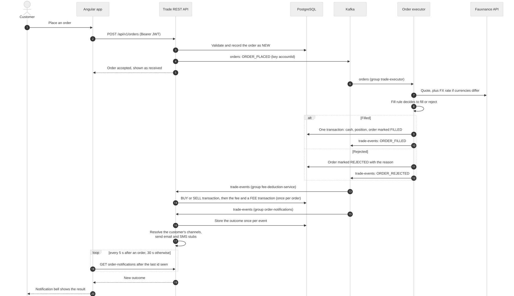

# Architecture

The Enterprise Trading Platform is three services, a PostgreSQL database and a Kafka broker, behind one Angular app. The services share the database but not each other's code: they talk over REST, Kafka topics and a signed token.

## System overview

| Component | Folder | Technology | Port | What it owns |
|---|---|---|---|---|
| Angular app | `Frontend/trading-ui` | Angular 21, generated API clients, Vitest, Playwright | 4200 | The screens for customers and admins. Holds no business rules |
| Auth service | `Services/auth-service` | NestJS 11, TypeScript, argon2id, Jest | 3000 | Users, login, registration, refresh tokens. Tables in the `auth` schema |
| Trade REST API | `Services/order-service` | Spring Boot, MyBatis | 8081 | Orders, accounts, portfolio and P&L, watchlists, price alerts, preferences, notifications, advice, strategies, admin |
| Order executor | `Services/executor-service` | Spring Boot, MyBatis | 8082 | Consumes orders, prices them, fills or rejects them, settles cash and positions, publishes the outcome |
| Analytics ETL | `ETL` | Python, DuckDB, Pandas, Plotly | none (command line) | Incremental load from PostgreSQL into a DuckDB star schema, and its reconciliation |
| PostgreSQL | `Database/postgres/*` | PostgreSQL 15+ | 5432 | Numbered migrations and seeds for the auth and trade tables, in one database |
| Kafka | `Infrastructure/Kafka` | Kafka in Docker | 9092 / 29092 | Topics `orders`, `trade-events`, `market-data` and their dead-letter topics |
| API contracts | `Frontend/trading-ui/contracts`, `Contracts` | OpenAPI | n/a | One YAML file per API. The Angular clients are generated from them |

## What happens when a customer places an order

- The order is accepted before it is executed. The customer sees "received" at once, and the real outcome arrives later through `trade-events` (decision 0013).
- `orders` and `trade-events` are keyed by account, so one account's events are always handled in order.
- The executor settles cash and the position. The BUY or SELL transaction row and the fee are recorded afterwards by the Trade REST API's `FeeDeductionService`, a second consumer of `trade-events`.
- Cancelling an order publishes `ORDER_CANCELLED` straight from the Trade REST API.

## Live prices and notifications

- The cache has exactly one writer, chosen by `market-data.quote-source` (decision 0009). It refreshes every five minutes to stay inside the 2,000-requests-a-day Fauxnance quota (decision 0010), and it survives restarts through a JSON snapshot (decision 0011).
- Which channels a message goes to comes from the customer's preferences. Admins have their own preferences and are told when a customer is registered (decision 0018).
- Email and SMS are logging stubs behind one interface, so nothing is delivered yet (decision 0014).

## Cross-cutting rules

**Authentication.** The auth service signs a JWT (HS256) after login. The Trade REST API checks it locally with the shared secret and issuer, so it never calls the auth service. The claims it relies on are `sub` (user id), `accountId` and `roles`. Access tokens last 15 minutes. Refresh tokens last 7 days, rotate on every use, and a replayed token revokes its whole family.

**Authorisation.** `/api/v1/admin/**` needs `ROLE_ADMIN`. Every account route also compares the token's `accountId` with the path and answers `ACC-403` on a mismatch. Automated strategies place orders with a one-minute token minted for that single call, with the role `STRATEGY`.

**Messaging.** Kafka delivery is at least once, so consumers acknowledge manually and store each event once (`event_id` is unique). The executor sends malformed orders to a dead-letter topic. If an event fails to reach Kafka, a replay scheduler publishes it again: `OrderReplayScheduler` in the Trade REST API for placed and cancelled orders, `OutcomeReplayScheduler` in the executor for outcomes.

**Contracts first.** Each API is written as OpenAPI before its controller, and the Angular app calls the backend only through the clients generated from those files (decision 0016).

## Scheduled work in the Trade REST API

| Job | When |
|---|---|
| Quote refresh from Fauxnance | Every 5 minutes (when `quote-source` is `FAUXNANCE`) |
| Price alert evaluator | Every 30 seconds |
| Strategy evaluator | Every 60 seconds |
| Candle sync | On start-up, daily at 01:00, retry at 02:00, purge of old candles on Mondays at 03:00 |
| Account history snapshot (net worth chart) | Daily at 23:59 UTC |

## Related documents

- [Sprint 10 features](sprint-10/README.md): what each feature does, module by module.
- [Decision log](sprint-10/decision-log/): why the design is the way it is.
- [Kafka topics design](../Services/order-service/design/kafka.md) and [market data poller quota](../Services/order-service/design/market-data-poller.md).
- [Security review](sprint-10/security-review/OWASP_SECURITY_REVIEW.md).

## Editing the diagrams

The sources are the `.mmd` files in [architecture/](architecture/). Edit one, then export it again to SVG, for example with the Mermaid CLI: `npx -p @mermaid-js/mermaid-cli mmdc -i architecture/system-overview.mmd -o architecture/system-overview.svg`. Pasting the text into [mermaid.live](https://mermaid.live) also works.
