# Enterprise Trading Platform

> **Team:** `chennai-capstone-SE2-team1`

A trading platform for customers and admins. Customers sign in, watch live prices, place limit orders that are
filled or rejected against real quotes, and follow their holdings, P&L, watchlists, price alerts and automated
strategies. Admins manage fees, register users and see platform analytics.

It is three services, a PostgreSQL database and a Kafka broker behind one Angular app, plus an analytics ETL.
Market data comes from the Fauxnance API.

---

## Table of contents

1. [Architecture](#architecture)
2. [Repository structure](#repository-structure)
3. [Tech stack](#tech-stack)
4. [Getting started](#getting-started)
5. [Tests and coverage](#tests-and-coverage)
6. [Documentation](#documentation)
7. [Sprint history](#sprint-history)

---

## Architecture



| Component | Folder | Port | What it does |
| :--- | :--- | :---: | :--- |
| Angular app | [`Frontend/trading-ui`](Frontend/trading-ui) | 4200 | Every screen for customers and admins; calls the APIs through generated clients |
| Auth service | [`Services/auth-service`](Services/auth-service) | 3000 | Users, login, registration, JWT access and refresh tokens |
| Order service (Trade REST API) | [`Services/order-service`](Services/order-service) | 8081 | Orders, accounts, portfolio and P&L, instruments, watchlists, price alerts, notifications, preferences, strategies, advice, admin |
| Executor service | [`Services/executor-service`](Services/executor-service) | 8082 | Fills or rejects orders from Kafka against live quotes, settles them, publishes outcomes and market data |
| Analytics ETL | [`ETL`](ETL) | n/a | Incremental load from PostgreSQL into a DuckDB star schema |
| PostgreSQL | [`Database/postgres`](Database/postgres) | 5432 | One database, `trading_system_db`, with the `auth` schema and the trade tables |
| Kafka | [`Infrastructure/Kafka`](Infrastructure/Kafka) | 9092 / 29092 | Topics `orders`, `trade-events`, `market-data` and their dead-letter topics |

An order goes from the UI to the order service, which validates it, reserves the cash and publishes
`ORDER_PLACED`. The executor prices it against a live quote, fills or rejects it, settles cash and positions,
and publishes the outcome on `trade-events`. The order service then deducts the fee and notifies the customer.
The full walk-through, with diagrams, is in [`Documents/architecture.md`](Documents/architecture.md).

**Ports and the database connection for every part are in one file:
[`Config/application.yaml`](Config/application.yaml).** The services, the frontend and the
Playwright tests read it; environment variables override it.

---

## Repository structure

```text
.
├── Config/                   # application.yaml: shared ports, URLs and database settings
├── Contracts/                # OpenAPI contracts shared across services (auth, trade, Fauxnance)
├── Database/
│   ├── schema.sql            # every table, index and function (all migrations, in order)
│   ├── seed_data.sql         # baseline and reference data (all seed INSERTs, in order)
│   ├── generate-sql.sh       # rebuilds the two files above from the migration and seed folders
│   ├── postgres/
│   │   ├── auth-service/     # migrations, seed and apply.sh for the auth schema
│   │   └── order-service/    # numbered migrations (001-026), seed and apply.sh for the trade tables
│   └── duckdb/analytics/     # the analytics star schema the ETL loads into
├── Documents/                # architecture, sprint 10 features and decision log, testing notes, runbooks
├── ETL/                      # Python analytics pipeline (extract, transform, load) and its tests
├── Frontend/trading-ui/      # Angular 21 app, its OpenAPI contracts and generated clients, Playwright E2E
├── Infrastructure/Kafka/     # broker and topic setup, single-message replay script
├── Services/
│   ├── auth-service/         # NestJS authentication service
│   ├── order-service/        # Spring Boot Trade REST API
│   └── executor-service/     # Spring Boot order executor and market data poller
├── .env.example              # canonical template for the .env every part reads
├── .example.env              # legacy alias kept in sync for older scripts/docs
└── manifest.env              # settings for the course's check harness
```

Every part has its own README with setup details (see [Documentation](#documentation)).

---

## Tech stack

| Layer | Technologies |
| :--- | :--- |
| Frontend | Angular 21 (standalone components, signals), TypeScript, OpenAPI Generator, Vitest, Playwright |
| Auth service | NestJS 11, TypeORM, argon2id, JWT (HS256), Jest |
| Order and executor services | Java 21, Spring Boot 3, MyBatis, Spring Kafka, JUnit 5, Mockito, JaCoCo |
| Data | PostgreSQL 15+ (numbered migrations), DuckDB (analytics) |
| Messaging | Apache Kafka (Docker) |
| Analytics | Python 3.11+, Pandas, DuckDB, Plotly, pytest |
| Market data | Fauxnance REST API (quotes, candles, symbol registry; 2000 requests a day) |
| Quality | SonarQube, JaCoCo, V8 coverage, Jest coverage |

---

## Getting started

### Prerequisites

- JDK 21 and Maven 3.9+
- Node.js 20.19+ (or 22.12+ / 24+) and npm 10+
- PostgreSQL 15+
- Docker, for Kafka
- Python 3.11+, only for the ETL
- A Fauxnance API key

### 1. Environment

```bash
cp .env.example .env
```

Fill in the database password, `FAUXNANCE_API_KEY`, `JWT_SECRET` (32+ bytes, shared by all services),
`PREFERENCES_CONTACT_KEY` and the Kafka host settings. Never commit `.env`.

### 2. Kafka

```bash
bash Infrastructure/Kafka/scripts/kafka-setup.sh
```

Starts the broker container on the host in `EC2_PRIVATE_IP` and creates the topics.
The services use `EC2_PRIVATE_IP` plus `kafka.port` from `Config/application.yaml`
(default `9092`).

### 3. Database

Create the database (`database.name` in `Config/application.yaml`, `trading_system_db` by default),
then run the schema and the seed data:

```bash
createdb trading_system_db
psql -v ON_ERROR_STOP=1 -d trading_system_db -f Database/schema.sql
psql -v ON_ERROR_STOP=1 -d trading_system_db -f Database/seed_data.sql
```

`schema.sql` creates every table, index and function (the `auth` schema and the trade tables);
`seed_data.sql` loads the baseline data: accounts, instruments, fees, sample orders and positions, known
account ids and the admin users. Both are generated from the numbered files in `Database/postgres/*/` by
`bash Database/generate-sql.sh`; run it after adding a migration or seed file.

The per-service scripts do the same thing in two steps and read the database name from `.env`:

```bash
bash Database/postgres/auth-service/apply.sh
bash Database/postgres/order-service/apply.sh
```

Canonical schema and seed sources:
- `Database/postgres/auth-service/migrations` and `Database/postgres/auth-service/seed`
- `Database/postgres/order-service/migrations` and `Database/postgres/order-service/seed`
- `Database/duckdb/analytics/analytics-schema.sql` (ETL contract)

### 4. Services

Start each in its own terminal, from its own folder:

```bash
cd Services/auth-service && npm ci && npm run build && npm start      # :3000
cd Services/order-service && mvn spring-boot:run                       # :8081
cd Services/executor-service && mvn spring-boot:run                    # :8082
cd Frontend/trading-ui && npm ci && npm start                          # :4200
```

Open http://localhost:4200 and sign in with a seeded user. The order service's health check is
http://localhost:8081/health, and the auth service's API docs are at http://localhost:3000/docs.

### 5. Deployment rehearsal workflow

For a repeatable local deployment rehearsal (env prep, Kafka bootstrap, schema migration/seed, service start,
health checks, and test smoke commands), follow:
[`Documents/deployment-rehearsal.md`](Documents/deployment-rehearsal.md).

The runbook also documents accepted local-only fallback behavior that must be overridden before any shared
environment deployment:
- JWT fallback in `ApiSecurityConfiguration` and `StrategyTokenIssuer`
- Preferences key fallback in `ContactDetailCipher`

---

## Tests and coverage

| Part | Unit tests | Line coverage |
| :--- | :--- | :---: |
| Frontend | `cd Frontend/trading-ui && npx ng test --watch=false` | 96.8% |
| Auth service | `cd Services/auth-service && npx jest --testPathIgnorePatterns integration` | 99.8% |
| Order service | `cd Services/order-service && mvn test` | 96.3% |
| Executor service | `cd Services/executor-service && mvn test` | 96.8% |
| ETL | `cd ETL && python -m pytest` | not measured |

End-to-end tests (`npm run e2e` in `Frontend/trading-ui`) run in Chromium, Firefox and WebKit and need
the whole platform running. Coverage commands, report locations and the integration tests that need live
services are in [`Documents/003_notes_on_testing_and_coverage.md`](Documents/003_notes_on_testing_and_coverage.md).

---

## Documentation

| Topic | Where |
| :--- | :--- |
| Architecture and the order lifecycle | [`Documents/architecture.md`](Documents/architecture.md) |
| Sprint 10 features (watchlists, alerts, notifications, preferences, P&L, charts, advice, strategies) | [`Documents/sprint-10/README.md`](Documents/sprint-10/README.md) |
| Design decisions | [`Documents/sprint-10/decision-log/`](Documents/sprint-10/decision-log/) |
| Security review | [`Documents/sprint-10/security-review/`](Documents/sprint-10/security-review/) |
| Testing and coverage | [`Documents/003_notes_on_testing_and_coverage.md`](Documents/003_notes_on_testing_and_coverage.md) |
| Deployment rehearsal runbook | [`Documents/deployment-rehearsal.md`](Documents/deployment-rehearsal.md) |
| Deployment verification results | [`Documents/004_deployment_verification.md`](Documents/004_deployment_verification.md) |
| Replayed orders never settle twice | [`Documents/001_notes_on_double_debit_replay_verification.md`](Documents/001_notes_on_double_debit_replay_verification.md) |
| SonarQube quality gate | [`Documents/002_notes_on_SonarQube_quality_gate.md`](Documents/002_notes_on_SonarQube_quality_gate.md) |
| Angular app | [`Frontend/trading-ui/README.md`](Frontend/trading-ui/README.md) |
| Auth service | [`Services/auth-service/README.md`](Services/auth-service/README.md) |
| Order service | [`Services/order-service/README.md`](Services/order-service/README.md) |
| Executor service | [`Services/executor-service/README.md`](Services/executor-service/README.md) |
| Analytics ETL | [`ETL/README.md`](ETL/README.md) |

---

## Sprint history

| Sprint | Delivered |
| :---: | :--- |
| 3 | PostgreSQL trade schema: numbered migrations, `CHECK` constraints, database-level idempotency |
| 4 | Analytics ETL into a DuckDB star schema, with quarantine of bad rows and a Plotly dashboard |
| 5 | Framework-free Java domain engine: entities, order placement rules, domain exceptions |
| 6 | Trade REST API: synchronous order placement in one transaction with optimistic locking, global error handling |
| 7 | Asynchronous execution over Kafka: order executor, duplicate-delivery protection, dead-letter topics, SonarQube gate |
| 8 | Auth service: registration, login, refresh-token rotation, roles, one answer for every login failure |
| 9 | Angular app: sign-in, route guards, order ticket, blotter, dashboard, Playwright journeys |
| 10 | Watchlists and price alerts, notifications, preferences, portfolio P&L, candle charts, trade advice, automated strategies, multi-currency, instruments and symbol discovery, account settings, shared platform configuration |
